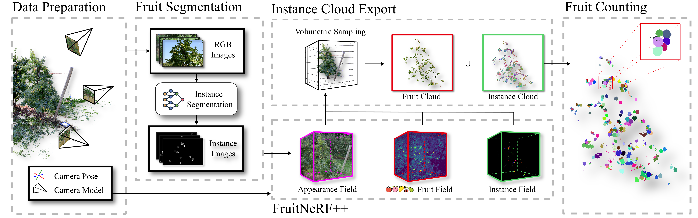
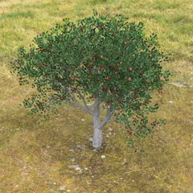
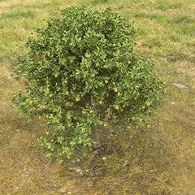
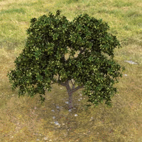
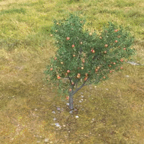
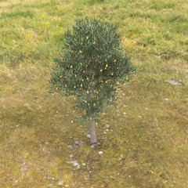
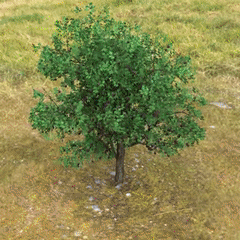
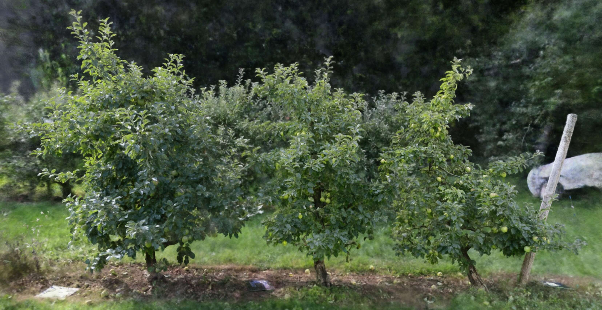

<h1 style="text-align: center;">:apple: :pear: FruitNeRF++: A Generalized Multi-Fruit Counting Method Utilizing Contrastive Learning and Neural Radiance Fields :peach: :lemon:</h1>

Lukas Meyer, Andrei-Timotei Ardelean, Tim Weyrich, Marc Stamminger,
<br>

<p align="center">
<a href="https://meyerls.github.io/fruit_nerfpp">🌐[Project Page]</a>
<a href="https://arxiv.org/abs/2505.19863">📄[Paper]</a>
</p>

<p style="align:justify"><b>Abstract</b>: We introduce FruitNeRF++, a novel fruit-counting approach that combines contrastive learning with neural radiance fields to count fruits from unstructured input photographs of orchards. Our work is based on FruitNeRF, which employs a neural semantic field combined with a fruit-specific clustering approach. The requirement for adaptation for each fruit type limits the applicability of the method, and makes it difficult to use in practice. To lift this limitation, we design a shape-agnostic multi-fruit counting framework, that complements the RGB and semantic data with instance masks predicted by a vision foundation model. The masks are used to encode the identity of each fruit as instance embeddings into a neural instance field. By volumetrically sampling the neural fields, we extract a point cloud embedded with the instance features, which can be clustered in a fruit-agnostic manner to obtain the fruit count. We evaluate our approach using a synthetic dataset containing apples, plums, lemons, pears, peaches, and mangoes, as well as a real-world benchmark apple dataset. Our results demonstrate that FruitNeRF++ is easier to control and compares favorably to other state-of-the-art methods. </p>

<p align="center">
    
</p>


# News

* Soon the [Dataset](https://zenodo.org/records/10869455) will be released.
* 14.12: Code release :rocket:
* 26.05.25: Released [Paper](https://arxiv.org/abs/2505.19863) on Arxiv
* 15.09.24: [Project Page](https://meyerls.github.io/fruit_nerfpp) released

# Installation

### Install Nerfstudio

<details>
  <summary>Expand for guide</summary>

#### 0. Install Nerfstudio dependencies

[Follow these instructions](https://docs.nerf.studio/quickstart/installation.html) up to and including "
tinycudann" to install dependencies and create an environment.

**Important**: In Section *Install nerfstudio* please install version **1.1.5** via `pip install nerfstudio==1.1.5` NOT
the latest one!

Install additional dependencies
```bash
pip install --upgrade pip setuptools wheel
pip install nerfstudio==1.1.5 # Important!!!
pip install pyntcloud==0.3.1
pip install hdbscan
pip install numba
pip install hausdorff
conda install docutils
```

#### 1. Clone this repo

`git clone https://github.com/meyerls/FruitNeRF.git`

#### 2. Install this repo as a python package

Navigate to this folder and run `python -m pip install -e .`

#### 3. Run `ns-install-cli`

#### Checking the install

Run `ns-train -h`: you should see a list of "subcommand" with fruit_nerf included among them.
</details>

### Install Grounding-SAM

<details>
  <summary>Expand for guide</summary>

Please install Grounding-SAM into the cf_nerf?segmentation folder. More details can be found
in [install segment anything](https://github.com/facebookresearch/segment-anything#installation)
and [install GroundingDINO](https://github.com/IDEA-Research/GroundingDINO#install). A copied variant is listed below.

```bash
# Start from FruitNerf root folder.
cd cf_nerf/segmentation 

# Clone GroundedSAM repository and rename folder
git clone https://github.com/IDEA-Research/Grounded-Segment-Anything.git groundedSAM
cd groundedSAM

# Checkout version compatible with FruitNeRFpp
git checkout fe24
```

You should set the environment variable manually as follows if you want to build a local GPU environment for
Grounded-SAM:

```bash
export AM_I_DOCKER=False
export BUILD_WITH_CUDA=True
export CUDA_HOME=/path/to/cuda-11.3/
```

Install Segment Anything:

```bash
python -m pip install -e segment_anything
```

Install Grounding DINO:

```bash
pip install --no-build-isolation -e GroundingDINO
```

Install diffusers and misc:

```bash
pip install --upgrade diffusers[torch]

pip install opencv-python pycocotools matplotlib onnxruntime onnx ipykernel
```

Download pretrained weights

```bash
# Download into grounded_sam folder
wget https://dl.fbaipublicfiles.com/segment_anything/sam_vit_h_4b8939.pth
wget https://github.com/IDEA-Research/GroundingDINO/releases/download/v0.1.0-alpha/groundingdino_swint_ogc.pth
```

Install SAM-HQ

```bash
pip install segment-anything-hq
```

Download SAM-HQ checkpoint from [here](https://github.com/SysCV/sam-hq#model-checkpoints) (We recommend ViT-H HQ-SAM)
into the Grounded-Segment-Anything folder.

**Done!**

</details>

### Install Detic

<details>
  <summary>Expand for guide</summary>

Please install Grounding-SAM into the cf_nerf?segmentation folder. More details can be found
in [install DETIC](https://github.com/facebookresearch/Detic/blob/main/docs/INSTALL.md). A copied variant is listed
below:

```bash
cd cf_nerf/segmentation 

git clone https://github.com/facebookresearch/detectron2.git
cd detectron2
pip install -e .
```

```bash
# Start from FruitNerf root folder (cf_nerf/segmentation ).
cd ..

# Clone GroundedSAM repository and rename folder
git clone https://github.com/facebookresearch/Detic.git --recurse-submodules
cd Detic
pip install -r requirements.txt

```

</details>

### Troubleshooting

<details>
  <summary>Expand for guide</summary>

No module cog

````BASH
pip install cog
````

No module fvcore

```bash
conda install -c fvcore -c iopath -c conda-forge fvcore
```

Error: name '_C' is not defined , UserWarning: Failed to load custom C++ ops. Running on CPU mode Only!
[Github Issue](https://github.com/IDEA-Research/Grounded-Segment-Anything/issues/436)

</details>

# 🍎 Using FruitNeRF++

> **Note**  
> The original working title of this project was **Contrastive-FruitNeRF (CF-NeRF)**.  
> Throughout the codebase, the project is referred to **exclusively as `cf-nerf`**.

Once FruitNeRF++ is installed, you are ready to start counting fruits 🚀  
You can train and evaluate the model using:

- **Your own dataset**
- Our **real or synthetic FruitNeRF Dataset**  
  👉 https://zenodo.org/records/10869455
- The **Fuji Dataset**  
  👉 https://zenodo.org/records/3712808

If you use **our FruitNeRF dataset**, you can **skip the data preparation step** and proceed directly to **Training**.

---

## 🗂️ Preparing Your Data

Your input data should consist of:

- An **image directory**
- A corresponding **`transforms.json`** file (NeRF camera poses)

If you do **not** already have a `transforms.json`, you can estimate camera poses using **COLMAP**.  
To enable automatic pose estimation, run the pipeline with:

```bash
--use-colmap
```

At this step the input should contain an image folder and a transform.json file! If you do not have a transform.json you may compute
the poses with COLMAP. Therefor please set ```--use-colmap```.

```bash
# Define your input parameter
INPUT_PATH="path/to/processed/folder" # Folder must have an *images* folder! Image files must be [".jpg", ".jpeg", ".png", ".tif", ".tiff"]
DATA_PATH="path/to/output/folder"
SEMANTIC_CLASS='apple' # string or a list is also possible

# Run processor 
 ns-process-fruit-data cf-nerf-dataset --data INPUT_PATH --output-dir DATA_PATH --num_downscales 2 --instance_model SAM --segmentation_class $SEMANTIC_CLASS --text_threshold 0.35 --box_threshold 0.35 --nms_threshold 0.2
```

<details>
  <summary>Expand for more options</summary>

```bash
usage: ns-process-fruit-data cf-nerf-dataset [-h] [CF-NERF-DATASET OPTIONS]

╭─ Some options ──────────────────────────────────────────────────────────────────────────────────────────────────────────────────────────────────────────────────────────────╮
│ -h, --help              show this help message and exit                                                                                                                     │
│ --data PATH             Path the data, either a video file or a directory of images. (required)                                                                             │
│ --output-dir PATH       Path to the output directory. (required)                                                                                                            │
│ --verbose, --no-verbose If True, print extra logging. (default: False)                                                                                                      │
│ --num-downscales INT    Number of times to downscale the images. Downscales by 2 each time. For example a value of 3 will downscale the                                     │
│                         images by 2x, 4x, and 8x. (default: 1)                                                                                                              │
│ --crop-factor FLOAT FLOAT FLOAT FLOAT                                                                                                                                       │
│                         Portion of the image to crop. All values should be in [0,1]. (top, bottom, left, right) (default: 0.0 0.0 0.0 0.0)                                  │
│ --same-dimensions, --no-same-dimensions                                                                                                                                     │
│                         Whether to assume all images are same dimensions and so to use fast downscaling with no autorotation. (default: True)                               │
│ --compute-instance-mask, --no-compute-instance-mask                                                                                                                         │
│                         Compute instance mask. (default: True)                                                                                                              │
│ --instance-model {SAM,DETIC,sam,detic}                                                                                                                                      │
│                         Which model to use. SAM or DETIC. (default: sam)                                                                                                    │
│ --segmentation-class {None}|STR|{[STR [STR ...]]}                                                                                                                           │
│                         Text threshold for DINO/SAM (default: fruit apple pomegranate peach)                                                                                │
│ --text-threshold FLOAT  Box threshold for DINO/SAM (default: 0.25)                                                                                                          │
│ --box-threshold FLOAT   NMS for fusing boxes (default: 0.3)                                                                                                                 │
│ --nms-threshold FLOAT   (default: 0.3)                                                                                                                                      │
│ --semantics-gt {None}|STR (default: None)                                                                                                                                   │
╰─────────────────────────────────────────────────────────────────────────────────────────────────────────────────────────────────────────────────────────────────────────────╯
```
</details>

The dataset should look like this:
```bash
apple_dataset
├── images
│   ├── frame_00001.png
│   ├── ...
│   └── frame_00XXX.png
├── images_2
│   ├── frame_00001.png
│   ├── ...
│   └── frame_00XXX.png
├── semantics
│   ├── frame_00001.png
│   ├── ...
│   └── frame_00XXX.png
├── semantics_2
│   ├── frame_00001.png
│   ├── ...
│   └── frame_00XXX.png
└── transforms.json
```

## 🚀 Training

To start training, use a dataset that follows the structure described in the previous section.  
Note that **cf-nerf** is available in two model sizes with different GPU memory requirements.

```bash
RESULT_PATH="./results"
ns-train cf-nerf-small \
  --data $DATA_PATH \
  --output-dir $RESULT_PATH \
  --viewer.camera-frustum-scale 0.2 \
  --pipeline.model.temperature 0.1
```

**Model variants:**
- `cf-nerf-small` → ~8 GB VRAM  
- `cf-nerf` → ~12 GB VRAM  

---

## 📦 Export Point Cloud

Adjust the parameters below according to your GPU and desired point cloud density:

- `--num_rays_per_batch`: depends on GPU VRAM  
- `--num_points_per_side`: controls point cloud density  
- `--bounding-box-min / --bounding-box-max`: adapt to your scene geometry  

```bash
CONFIG_PATH="./results/[MODEL/RUN_FOLDER]/config.yml"
PCD_OUTPUT_PATH="./results/[MODEL/RUN_FOLDER]"

ns-export-semantics instance-pointcloud \
  --load-config $CONFIG_PATH \
  --output-dir $PCD_OUTPUT_PATH \
  --use-bounding-box True \
  --bounding-box-min -1 -1 -1 \
  --bounding-box-max  1  1  1 \
  --num_rays_per_batch 2000 \
  --num_points_per_side 1000
```

---

## 🔢 Count Fruits

To count fruits, the extracted point cloud—containing **Euclidean coordinates** and **feature vectors**—is clustered to identify individual fruit instances.

```bash
ns-count \
  --load_pcd $PCD_OUTPUT_PATH \
  --output_dir $PCD_OUTPUT_PATH \
  --lambda-eucl-dist 1.2 \
  --lambda-cosine 0.5
```

**Parameters:**
- `--lambda-eucl-dist`: weight for spatial (Euclidean) distance  
- `--lambda-cosine`: weight for feature similarity (cosine distance)  

Adjust these weights to balance geometric proximity and semantic similarity for your dataset.

<details>
  <summary>Expand for more options</summary>

```bash
usage: ns-count [-h] [OPTIONS]

Count instance point cloud.

╭─ options ────────────────────────────────────────────────────────────────────────────────╮
│ -h, --help              show this help message and exit                                  │
│ --load-pcd PATH         Path to the point cloud files. (required)                        │
│ --output-dir PATH       Path to the output directory. (required)                         │
│ --gt-pcd-file {None}|PATH|STR                                                            │
│                         Name of the gt fruit file. (default: None)                       │
│ --lambda-eucl-dist FLOAT                                                                 │
│                         euclidean term for distance metric. (default: 1.2)               │
│ --lambda-cosine FLOAT   cosine term for distance metric. (default: 0.2)                  │
│ --distance-threshold FLOAT                                                               │
│                         Distance (non metric) to assign to gt fruit. (default: 0.05)     │
│ --staged-max-points INT                                                                  │
│                         Maximum number of points for staged clustering (default: 600000) │
│ --clustering-variant STR                                                                 │
│                         (default: staged)                                                │
│ --staged-num-clusters INT                                                                │
│                         (default: 30)                                                    │
╰──────────────────────────────────────────────────────────────────────────────────────────╯
```
</details>

# Download Data
To reproduce our counting results, you can download the extracted point clouds for every training run. Download can be 
found here: tbd.

## Synthetic Dataset

<p align="center" >
    
    
    
    
    
    
</p>

Link: [](https://doi.org/10.5281/zenodo.10869455)

## Real Dataset



Link: [](https://doi.org/10.5281/zenodo.10869455)


## Bibtex

If you find this useful, please cite the paper!
<pre id="codecell0">
@inproceedings{fruitnerfpp2025,
  author    = {Meyer, Lukas and Ardelean, Andrei-Timotei and Weyrich, Tim and Stamminger, Marc},
  title     = {FruitNeRF++: A Generalized Multi-Fruit Counting Method Utilizing Contrastive Learning and Neural Radiance Fields},
  booktitle = {2025 IEEE/RSJ International Conference on Intelligent Robots and Systems (IROS)},
  year      = {2025},
  doi       = {10.1109/IROS60139.2025.11247341},
  url       = {https://meyerls.github.io/fruit_nerfpp/}
}
 </pre>
